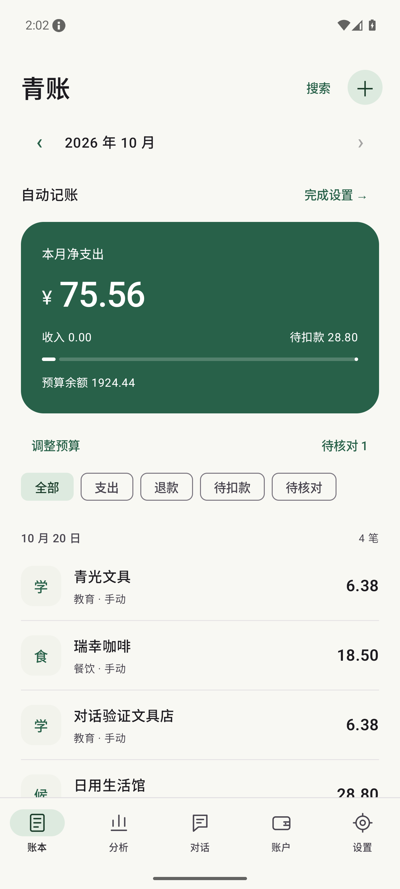
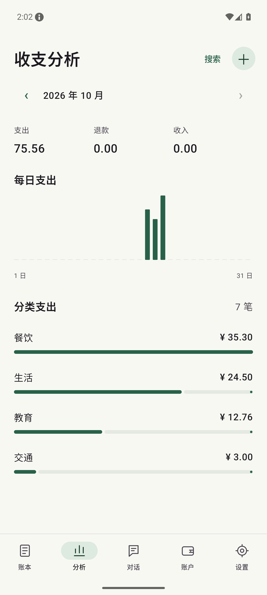
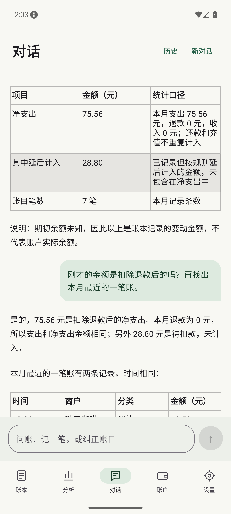

# 青账

Android 本地加密账本。用 Pi 分析交易、分类商品、对话记账和查询；账本与执行记录保存在手机，模型接口由使用者配置。

[下载 APK](https://github.com/Yi-ming-Zhao/keeping-accounts/releases/latest) · [实际验证范围](docs/COVERAGE.md) · [版本记录](CHANGELOG.md)

## 0.2.1

- 补读服务恢复连接后仍在通知栏中的支付通知，不必先打开订单详情。
- 逐条处理支付消息，支持同行金额字段；重复推送去重，同额不同消息分别保留。
- 修复带搜索框、合并文字节点和持续刷新的订单页漏采集。
- 采集设置显示服务实际连接状态，支持展开和复制不含交易正文的诊断信息。

本版沿用原签名，可直接覆盖 0.2.0。已通过模拟器系统服务、金额解析和保留数据升级检查；vivo、真实微信通知及京东/拼多多当前页面仍待实际使用验证。[本版验证记录](docs/RELEASE_0.2.1.md)。

## 主要功能

- 金额按语义选择：实付款优先于商品原价和优惠；相互冲突时等待核对。
- 先用后付下单记录为待扣款，扣款后通过订单号更新原记录；未扣款前不计现金支出。
- 通知、页面、订单与支付号关联；同额不同订单和不同支付流水仍分别保留。
- 持续对话、历史会话、取消和继续；原生 Markdown 展示，回答内可打开相关账目。
- 账本搜索、月预算、每日趋势、分类支出、账户净变动、完整账目详情。
- 金额、商户、分类和备注可纠正并撤销；规则必须明确选择“以后按此分类”。
- 商品名称先保存在本机，再由模型分类。缺少实付分摊证据时不会将商品原价当作实付价。
- GitHub 更新检查、新图标、浅色和深色界面。

页面与通知测试通过独立的交易样本 APK 触发 **真正的 Android 采集服务**。这不是对京东、拼多多等第三方应用当前页面的实测承诺。尚未连接 vivo 真机或登录这些应用，详细边界见覆盖清单。

## 界面

以下使用构造账目；对话为真实模型结果。

  

## 使用

支持 Android 11+、ARM64。本机截图识别需要 Android 14+。从已发布旧版升级直接覆盖安装，不要卸载。

1. 设置 → 模型：填写 HTTPS 接口、模型和密钥，点击“验证并保存”。默认地址 `https://api.deepseek.com`，模型 `deepseek-flash`。APK 不含密钥。
2. 设置 → 采集：按应用授权，再打开系统通知读取和页面读取。vivo 还需允许自启动与后台运行；设置中有系统入口。
3. 打开已有付款或订单页，或分享交易文字/截图到青账。服务不会打开、点击或翻动其他应用。
4. 对话中可问“本月花了多少”“最近有哪些退款”，也可说“记一笔，食堂午饭花了18.50元”。修改账目后可在详情查看来源和撤销。
5. 设置 → 检查更新，可查看发布说明并前往 GitHub 下载新版本。

旧版金额不会被无提示改写。新版会复核已有文字证据，把明确的金额冲突放入待核对；打开详情 → 编辑即可纠正。

## 隐私

无应用账号、广告、行为统计或自建转发服务。Room + SQLCipher 加密账本，Android Keystore 保护数据库密钥、模型密钥和证据图片。禁止系统云备份。

只有授权应用的交易相关字段可保存和发送给用户配置的模型。图片识别与图片外发分别开关，默认均关闭。截图先在本机识别，外发图片只包含能够可靠隔离的金额与状态区域；原始整页截图不会发送。图片默认七天后清理。

主动备份使用密码加密，包含账本、文字证据、对话和工具执行凭据；不含图片与模型配置。恢复会替换现有账本。Markdown 不使用网页视图，不执行 HTML/JavaScript，不自动下载远程图片。更新检查仅在用户点击时请求 GitHub。

## 构建

需要 JDK 17、Node.js 22+、Android SDK 36。Gradle 8.13、AGP 8.13.2；R8 9.1.56 用于兼容 QuickJS 依赖的 Kotlin 元数据。

```sh
npm ci
# local.properties: sdk.dir=/你的/Android/sdk
bash scripts/android-env.sh :app:assembleDebug
python3 scripts/setup-signing.py
bash scripts/android-env.sh :app:assembleRelease
```

正式包位于 `app/build/outputs/apk/release/app-release.apk`。本地签名存放于忽略目录 `.local/`，必须保留同一签名才能持续覆盖升级。自行生成的签名不能覆盖安装官方发布的包；更换发行签名前先在应用内导出加密备份。

构建时打包官方 `@earendil-works/pi-agent-core`；手机内由 QuickJS 运行，Kotlin 提供网络、数据库和调度能力。没有替换成自写 agent。单次任务最多六轮模型交互、两分钟，网络暂时失败最多退避重试两次。

## 验证

```sh
npm test
bash scripts/android-env.sh :app:testDebugUnitTest :app:assembleDebug :app:assembleDebugAndroidTest :fixtures:assembleDebug
python3 scripts/device-tests.py
python3 scripts/capture-service-tests.py
```

服务测试会安装独立样本应用，修改模拟器的测试权限，**只允许运行在 emulator-5554**。它不会登录或操作支付应用，也不会发起真实支付。数据库测试使用隔离数据库；界面与采集测试使用模拟器主账本。

真实模型验证：创建忽略文件 `model-key.txt`（权限 0600）及 `model-config.local.json`：

```json
{"baseUrl":"https://api.deepseek.com","model":"deepseek-flash","images":false}
```

```sh
TEST_METHOD=dev.localledger.LedgerIntegrationTest#liveDiscountedGoodsAndPersistentConversation python3 scripts/live-probe.py
```

脚本经标准输入写入 debug 应用私有目录，完成后删除临时配置，不将密钥放入命令行参数或日志。调用会使用配置账户的模型额度。

## 边界

- 系统看不到的支付不会凭空出现；无可读通知、无障碍节点或截图权限时，需要分享单据或手动补充。
- 受保护页面不绕过。非授权应用不采集，无关聊天不保存。
- 自动金额解析目前只接受人民币，显式外币单据不会冒充人民币。
- 商品字段依赖可读标签或语义清晰的节点，应用更新和混淆节点可能影响识别；不能承诺任何应用所有页面都可自动提取。
- 没有共同编号的重复页面或跨应用事件不能保证自动合并，不用金额和时间相近强行合并。
- 先用后付扣款记录没有共同订单号时，需要人工核对待扣款记录；页面只有“开通先用后付”广告不会记账。
- 未知交易时间使用采集时间；账户展示已记录的净变动，不是银行或支付账户实际余额。
- 备份解压后限 32 MB。当前不自动导入其他记账软件数据库。

## 依赖与图标

依赖许可位于 `app/src/main/assets/notices/`。中文 OCR 模型来源与校验见 `app/src/main/assets/tessdata/manifest.json`。图标由内置 imagegen 生成，原图和提示词见 [design/ICON.md](design/ICON.md)。
